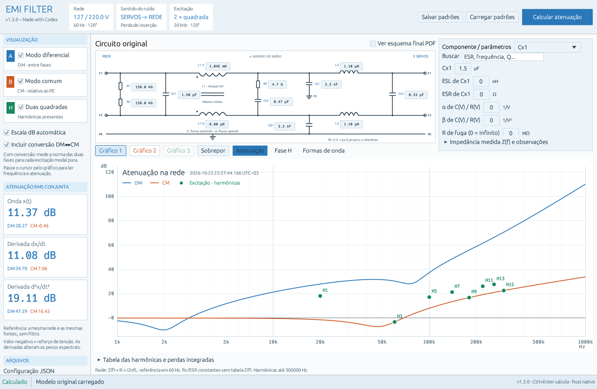

# EMI Filter v1.3.0

## Documentação completa na primeira versão

A apresentação do projeto, o circuito e os fundamentos do modelo estão na
[documentação da v1.0.0](https://github.com/diegotine/emi-filter/blob/v1.0.0/README.md).
Este README apresenta apenas as alterações da nova versão. As funções e os
parâmetros atuais estão descritos no [manual de referência](docs/MANUAL.md).

## Alterações da v1.3.0

- Painel azul de parâmetros à direita do esquema, liberando altura para o gráfico.
- Valor principal, perdas, parasitas e demais parâmetros reunidos por componente,
  com busca e opção de salvar/carregar padrões pessoais.
- Barra compacta: **Gráfico 1 · Gráfico 2 · Gráfico 3 · Sobrepor · Atenuação ·
  Fase H · Formas de onda**. Novo gráfico disponível no menu do botão direito.
- Título, timestamp e legenda dentro da grade; legenda de L1 dentro do esquema,
  entre L1 Δ e PE. O gráfico cresce com a altura disponível da janela.
- Frequência em escala logarítmica com limite padrão de **1 MHz**; eixo Y linear
  em dB. A série harmônica permanece até **300 kHz**. Sessões e padrões pessoais
  preservam a faixa que foi salva.
- Três resultados com histórico, revisão e sobreposição por cores; timestamp
  individual e sessões JSON com identificação de versão e modelo.
- Fase da transferência e reconstrução das ondas/derivadas com H complexa,
  incluindo conversão DM↔CM, bypass de Cx3 e parasitas opcionais.
- Parâmetros adicionais para acoplamento, fuga, duty, ringing e tabelas Z(f).
  O modelo continua linear; coeficientes não lineares ativos bloqueiam o cálculo.
- Título da janela: **EMI Filter v1.3.0 -- Made with Codex**.
- Executáveis atualizados para **Linux x86_64** e **Windows 10/11 x86_64**.
- Rodapé esclarece que a impedância da rede varia conforme `Z(f)=R+j2πfL`;
  Rs/ESR dos componentes são constantes sem tabela Z(f). Tooltip mostra valores
  da rede em frequências diferentes. Arquivos v1.3.0 substituídos com essa correção.

As funções incorporadas nas entregas locais 1.1/1.2 estão incluídas nesta
publicação; o histórico público anterior é a v1.0.0. As equações do circuito
foram preservadas nesta atualização de layout e faixa da varredura.

## Downloads

Baixe na [release v1.3.0](https://github.com/diegotine/emi-filter/releases/tag/v1.3.0):

- Linux: `emi-filter-v1.3.0-linux-x86_64` ou `emi-filter-v1.3.0-linux-x86_64.tar.gz`.
- Windows: `emi-filter-v1.3.0-windows-x86_64.exe` ou `emi-filter-v1.3.0-windows-x86_64.zip`.

Cada sistema usa um executável com cálculo e recursos incorporados, sem instalar
Rust ou Python. No Linux, dê permissão com `chmod +x emi-filter-v1.3.0-linux-x86_64`;
esta compilação requer glibc 2.43 e bibliotecas gráficas do sistema.
No Windows, abra o `.exe`; a execução em Windows ainda não foi verificada.
Hashes SHA-256 acompanham os downloads.

Validação e reprodução: [VALIDACAO.md](VALIDACAO.md),
[manual](docs/MANUAL.md) e [compilação Windows](WINDOWS_BUILD.md).
Código sob [MIT](LICENSE); [avisos de terceiros](THIRD_PARTY_NOTICES.md).
